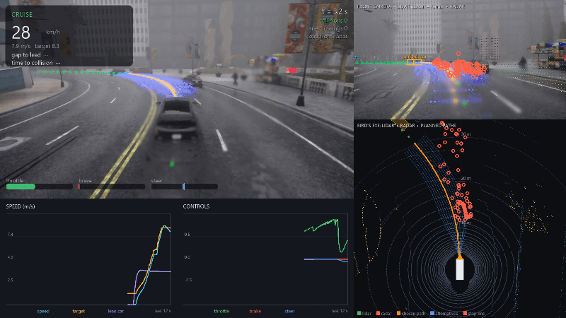
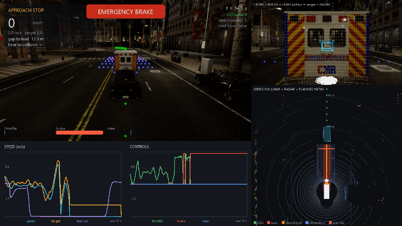
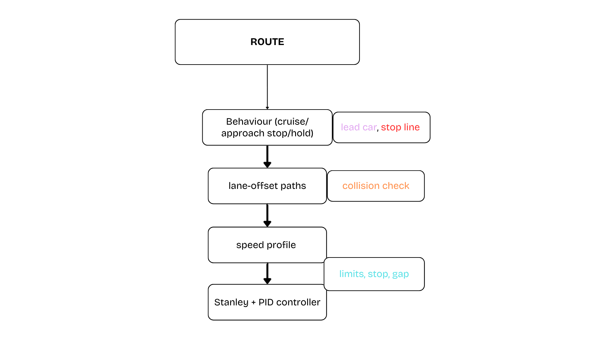

# Motion planning and validation demo for CARLA 0.9 (Unreal Engine 4)

A planner and controller that drive a car down a lane towards an intersection
in CARLA. On the way it swerves around a parked car, follows a slower lead
car, stops at a line, waits, and turns. Optional lidar, radar and camera
sensors add a safety brake, radar based lead tracking and a dashboard video,
and every run ends with a metrics report (collisions, gaps, comfort, stop
position, PASS/FAIL).



## Run it

1. Start CARLA (the Unreal Editor with Play pressed, or a packaged build).
2. In a terminal, with the Python version you built the CARLA API for:

```
python -m pip install numpy matplotlib pillow imageio imageio-ffmpeg
python -m pip install <carla folder>\PythonAPI\carla\dist\carla-*.whl
python carla_motion_planning.py
```

Common options:

| Option | What it does |
| --- | --- |
| `--dashboard` | records `controller_output/dashboard.mp4`, a multi-panel video (below) |
| `--aeb` | lidar based emergency brake as a safety layer |
| `--radar-lead` | find the lead car with the radar instead of simulator ground truth |
| `--headless` | no rendering, fast batch run, no video |
| `--weather HardRainNoon` | weather preset |
| `--town Town03`, `--start-index N`, `--turn left` | choose map, start point, direction |
| `--no-lead`, `--no-parked` | remove the lead car or the parked car |
| `--ego-car vehicle.tesla.model3`, `--list-cars` | choose the car |
| `--camera overhead\|chase\|free` | Editor camera while it runs |
| `--record` | simpler single-camera video |
| `--save-replay NAME` | CARLA recorder file, replayable and filmable from any angle |

Ctrl+C stops cleanly and puts the simulator back into normal mode.

## Outputs (`controller_output/`)

* `dashboard.mp4`: chase camera with HUD, front camera with lidar points, radar
  detections and 3D boxes, a bird's eye view of lidar, radar and the planner's
  candidate paths, and rolling speed / control charts.
* `kpi_report.json` and a printed table: collisions, lane marking crossings,
  minimum gap and time to collision, stop position relative to the line, peak
  acceleration, deceleration and lateral acceleration, emergency braking time.
* `trajectory.png`, `controls.png`, `trajectory.txt`.



## How it works


```
```

`offline_sim.py` runs the whole planning and control stack against a simple
vehicle model, with no CARLA, as a quick regression test:

```
python offline_sim.py
python offline_sim.py --no-lead --lead-speed 2.0
```

## Files

| File | Role |
| --- | --- |
| `carla_motion_planning.py` | CARLA client: scenario, actors, main loop |
| `motion_planner.py` | planning pipeline behind one `update()` call |
| `route.py` | global route as a polyline with arclength coordinates |
| `behaviour.py` | stop line state machine, lead vehicle selection |
| `paths.py` | lane-offset candidate paths and collision checking |
| `speed.py` | speed profile (limits, stop point, gap keeping) |
| `control.py` | Stanley steering and PI speed control |
| `perception.py` | lidar / radar processing, safety brake, radar lead tracker |
| `sensor_rig.py` | sensors on the car and synchronised reading |
| `dashboard.py` | dashboard video frames |
| `kpi.py` | run metrics and report |
| `scenario.py`, `offline_sim.py` | synthetic road and closed loop test |
| `make_video.py` | encode saved PNG frames to MP4 |

### Tested hardware

| | |
|---|---|
| CPU | Intel i5-8400 |
| GPU | AMD Radeon RX 6700 XT (no CUDA unfortunately lol see below) (I am team RED Always) |
| RAM | 16 GB DDR4 |
| OS | Windows |

I got to know the true limits of my hardware in this project. The processor matters a lot for unreal engine and its compilation (also shader compilations). 
Plus, try to have it installed on an SSD. I had it installed on a HDD, and everytime it took around 20 mins for it to load up. 

## Credits

Sensor handling follows patterns from the examples that ship with CARLA
(`sensor_synchronization.py`, `visualize_multiple_sensors.py`,
`lidar_to_camera.py`, `bounding_boxes.py`), which are MIT licensed.

## License

MIT License - see [LICENSE](LICENSE).
